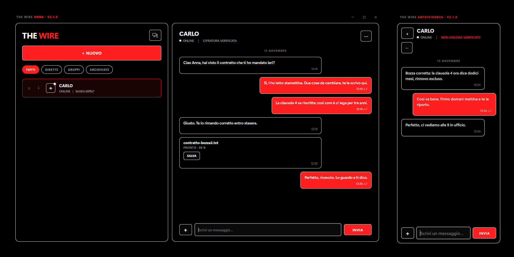
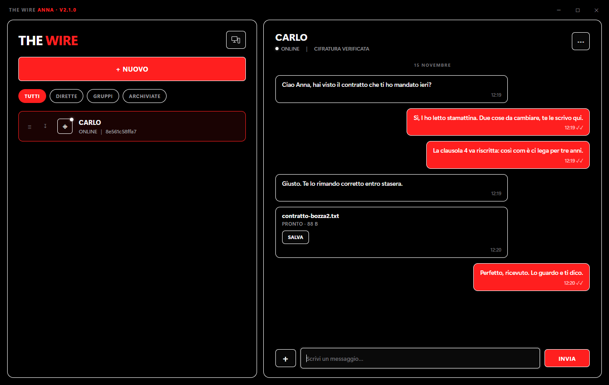
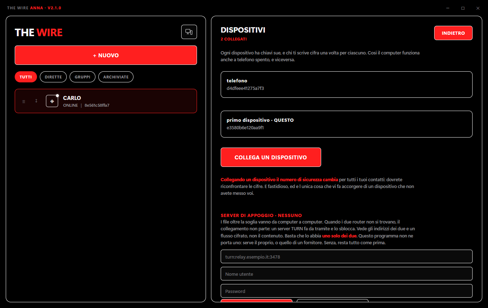
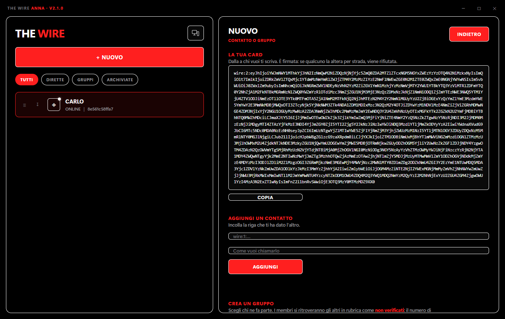
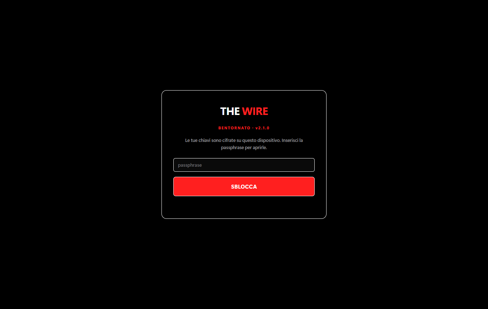
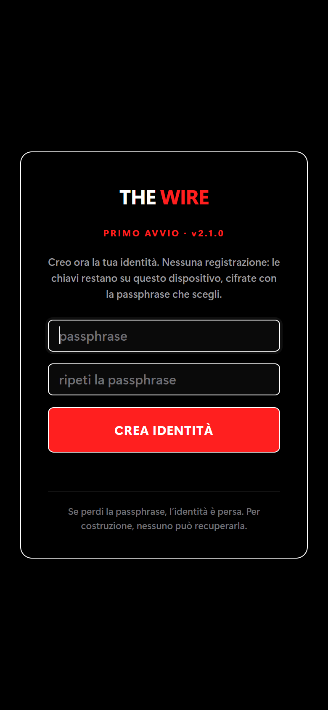
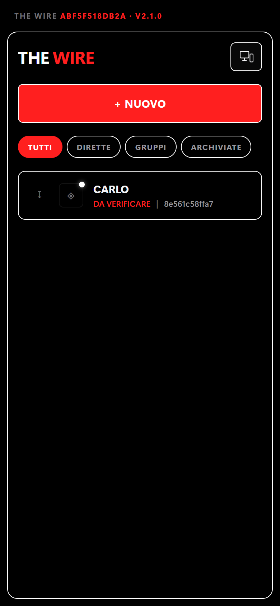
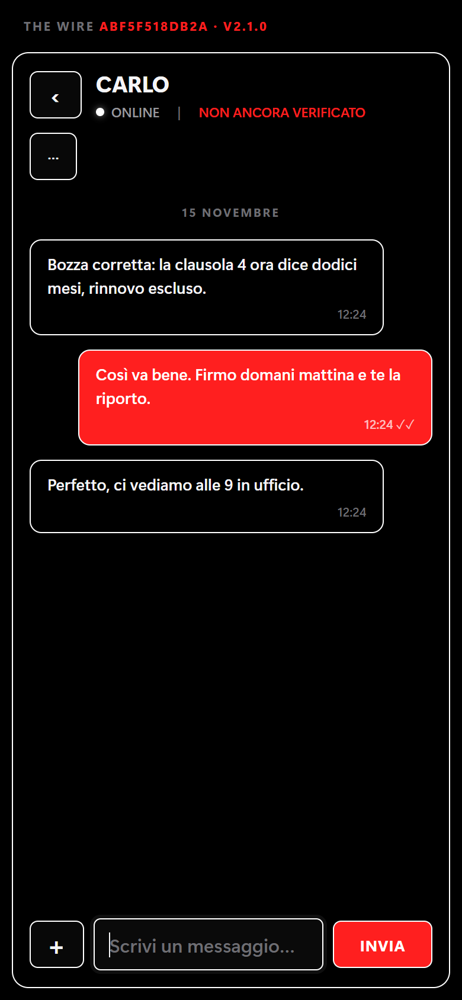
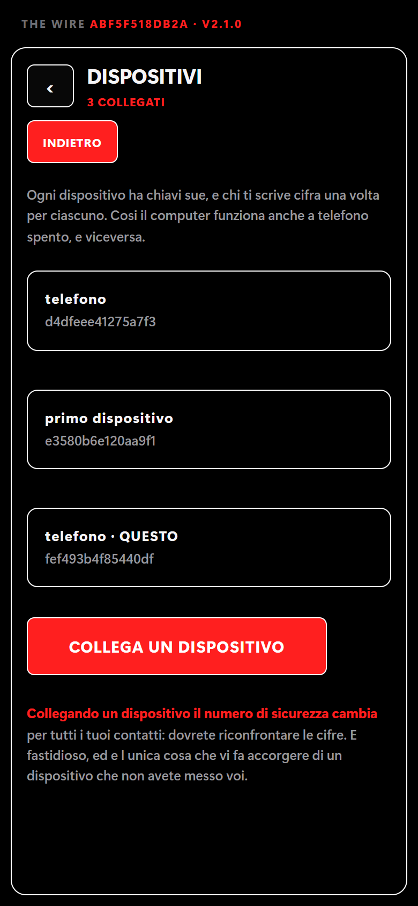

<p align="center">
  
</p>

<h1 align="center">THE WIRE</h1>

<p align="center">
  Messaggistica cifrata da persona a persona.<br>
  <b>Nessun account. Nessun server da pagare. Nessuna azienda in mezzo.</b>
</p>

<p align="center">
  
  
  
  
  
  
</p>

---

## Cos'è

Un programma per scriversi, mandarsi file e tenere gruppi, con la cifratura
punto‑a‑punto di Signal (X3DH + Double Ratchet) e **senza nessun server
nostro**: i messaggi passano da relay pubblici e gratuiti che non vedono né il
contenuto né chi scrive a chi. Le chiavi nascono sul tuo dispositivo e non
escono da lì. Se perdi la passphrase, l'identità è persa: per costruzione,
nessuno può recuperarla.

Lo stesso account vive su **computer e telefono insieme**: chi ti scrive cifra
una copia per ciascun dispositivo, e quello che scrivi da uno compare
sull'altro. Il telefono funziona a computer spento.

## Punti forti

- **Zero infrastruttura.** Niente registrazione, niente numero di telefono,
  niente server da tenere acceso. Chiudi il programma e non resta nulla in
  rete che ti appartenga.
- **Cifratura seria, primitive audite.** X25519, Ed25519, XChaCha20‑Poly1305,
  HKDF, Argon2id (64 MB, 3 passate) — tutte da `@noble`, TypeScript puro,
  nessuna dipendenza nativa. Chiave nuova a ogni messaggio: chi ne ruba una non
  legge né i precedenti né i successivi.
- **Il relay non sa niente.** Doppia cifratura (ratchet + NIP‑44) dentro un
  involucro NIP‑59 firmato da una chiave usa‑e‑getta: il relay vede un
  pacchetto opaco e un indirizzo di arrivo. Cinque relay in parallelo, basta
  che due persone ne abbiano uno in comune.
- **Arriva anche se l'altro è spento.** Il primo messaggio e i file fino a 5 MB
  si depositano nei relay e vengono ritirati alla prossima apertura.
- **File senza limite di dimensione.** Oltre i 5 MB il file va da computer a
  computer su un collegamento diretto (WebRTC): i byte non toccano nessun
  server, un file da 100 GB non passa mai per la memoria, un trasferimento
  interrotto riprende da dove era. Se i router non si trovano, un server TURN
  opzionale (il proprio, o di un fornitore) fa da tramite.
- **Più dispositivi, un solo account.** Si collega il telefono inquadrando un
  QR; da quel momento rubrica e conversazioni arrivano su entrambi.
- **Numero di sicurezza.** Sessanta cifre da confrontare a voce: è l'unico
  momento in cui l'uomo‑nel‑mezzo viene escluso davvero, e cambia se qualcuno
  aggiunge un dispositivo che non doveva.
- **Tutto sul disco è cifrato.** Chiavi, storico e file ricevuti stanno in un
  deposito protetto da Argon2id; dopo dieci minuti senza nessuno l'account si
  blocca da solo.
- **Un cuore solo, quattro facce.** Il protocollo sta in un unico pacchetto
  TypeScript condiviso da Windows, macOS, Android e web app: non esistono due
  implementazioni da tenere allineate.

## Difetti e limiti, detti prima

- **Il grafo delle conversazioni non è protetto.** Il relay non legge e non sa
  chi manda, ma vede chi riceve e quando: un osservatore paziente può
  correlare i tempi. È il limite strutturale, e non si risolve senza cambiare
  trasporto.
- **Il Double Ratchet è un'implementazione originale**, scritta e testata con
  cura ma **non sottoposta a revisione esterna**. Un difetto nella macchina a
  stati ha già reso muta una conversazione reale (corretto, e coperto da test).
  Va bene fra amici. Non usarlo dove la riservatezza è questione di sicurezza
  personale: per quello esiste Signal.
- **Niente notifiche push.** Richiederebbero un server che sa quando arriva un
  messaggio e per chi — esattamente ciò che il programma evita di far
  esistere. I messaggi si vedono aprendo l'app.
- **Dipende da relay di volontari.** Che uno o due non rispondano è normale;
  se cadessero tutti e cinque, nulla parte. Non c'è un piano B automatico.
- **I file grandi richiedono entrambi collegati**, e certe coppie di router non
  si trovano senza un TURN. Dal telefono i file oltre 5 MB non partono.
- **Lo storico non si copia su un dispositivo nuovo.** Il telefono riceve quello
  che arriva dopo il collegamento, non quello di prima.
- **iPhone senza App Store significa web app.** Apple non installa app fuori
  dallo store: resta la cartella statica su HTTPS aggiunta alla schermata Home
  (funziona e non scade), oppure Xcode con un ID gratuito che scade dopo 7
  giorni.
- **I pacchetti non sono firmati.** Windows avvisa, macOS chiede tasto destro →
  Apri la prima volta. Firmarli costa un certificato e un account Developer.
- **Non ci sono ancora**: file nei gruppi, aggiunta di membri a un gruppo già
  creato, chiamate.

## Schermate

### Computer (Windows e macOS)

<table>
  <tr>
    <td align="center"><br><sub>Conversazione verificata, con un file ricevuto</sub></td>
    <td align="center"><br><sub>Dispositivi collegati e server di appoggio opzionale</sub></td>
  </tr>
  <tr>
    <td align="center"><br><sub>La propria card, i contatti, i gruppi</sub></td>
    <td align="center"><br><sub>Sblocco: la passphrase apre il deposito cifrato</sub></td>
  </tr>
</table>

### Telefono (Android e iPhone)

<table>
  <tr>
    <td align="center"><br><sub>Primo avvio</sub></td>
    <td align="center"><br><sub>Le conversazioni</sub></td>
    <td align="center"><br><sub>La stessa chat del computer</sub></td>
    <td align="center"><br><sub>Collegare il telefono</sub></td>
  </tr>
</table>

Le schermate sono state prese il 15 novembre 2026 da due programmi desktop e
dalla web app aperti sullo stesso PC, con una conversazione vera passata dai
relay: non sono mockup.

## Installare

Tutto sta nella [pagina delle release](../../releases): un file per sistema.

| Sistema | File | Come |
|---|---|---|
| **Windows** 10/11 | `THE-WIRE-Setup-2.1.0.exe` | Doppio clic. Si installa per l'utente corrente e mette l'icona sul desktop. SmartScreen avvisa perché non è firmato: *Ulteriori informazioni → Esegui comunque*. |
| **macOS** (Apple Silicon e Intel) | `THE-WIRE-2.1.0-arm64.dmg` / `THE-WIRE-2.1.0-x64.dmg` | Apri il DMG e trascina in Applicazioni. La prima volta **tasto destro → Apri** (non è firmato). Se insiste: `xattr -cr "/Applications/THE WIRE.app"`. |
| **Android** | `THE-WIRE-Android.apk` | Copia sul telefono e apri: Android chiede di consentire l'installazione da fonti sconosciute. Niente Play Store, niente indirizzo web. |
| **iPhone** (e Android senza installare) | `THE-WIRE-telefono.zip` | È la web app: la cartella va su un indirizzo **HTTPS** (GitHub Pages va benissimo). Dal telefono si apre quell'indirizzo — **con Safari** su iPhone — e si aggiunge alla schermata Home. Dettagli in [LEGGIMI-telefono.md](LEGGIMI-telefono.md). |

> **Nota su iPhone e questo repository.** GitHub Pages pubblica solo da
> repository pubblici (o con piano a pagamento). Finché questo repo è privato,
> la cartella `apps/pwa/sito` va messa su un altro indirizzo HTTPS, oppure il
> repo va reso pubblico: nei file non c'è nulla di segreto, le chiavi nascono
> sul dispositivo di chi installa.

### Primi passi

1. Al primo avvio scegli una passphrase di **almeno 12 caratteri**. Generare le
   chiavi richiede 2‑3 secondi: è Argon2id che lavora, ed è voluto.
2. **NUOVO** mostra la tua card, una riga `wire:2:…`. Scambiatela su un canale
   qualunque e incollate quella dell'altro con un nome.
3. Confrontate a voce il **numero di sicurezza** (60 cifre). Se coincide,
   confermate: da lì la conversazione è verificata.
4. **DISPOSITIVI › COLLEGA UN DISPOSITIVO** sul computer mostra un QR; sul
   telefono lo stesso pulsante apre la fotocamera. Il QR contiene la chiave
   privata dell'account: mostralo il tempo di inquadrarlo, non di più.

## Come funziona, in breve

| Cosa | Come |
|---|---|
| Apertura della conversazione | X3DH |
| Messaggi | Double Ratchet: chiave nuova a ogni messaggio, forward secrecy e post‑compromise security |
| Consegna | Relay Nostr pubblici; busta NIP‑59 firmata da chiave usa‑e‑getta, contenuto NIP‑44 sopra il ratchet |
| Deposito | Argon2id (64 MB, 3 passate) → XChaCha20‑Poly1305; scrittura atomica (tmp + rename) |
| File ≤ 5 MB | A pezzi da 16 KB dentro il ratchet, dai relay, anche a destinatario spento |
| File > 5 MB | WebRTC fra i due computer, pezzi fino a 256 KB, controllo di flusso, ripresa; TURN opzionale |
| Presenza | Un battito cifrato ogni 45 s su un canale effimero, fuori dal ratchet |
| Più dispositivi | Una chiave d'account firma i dispositivi; ogni mittente cifra una copia per ciascuno |
| Sul telefono | Lo stesso cuore, compilato per il browser; deposito in IndexedDB; Capacitor per l'APK |

Il protocollo è spiegato per intero, con le ragioni di ogni scelta, in
[docs/ARCHITETTURA.md](docs/ARCHITETTURA.md). Cosa protegge e cosa **non**
protegge, con i file da leggere per verificarlo, in [SICUREZZA.md](SICUREZZA.md).

## Costruire dai sorgenti

Serve solo Node.js 22. Nessun compilatore, nessuna libreria di sistema.

```bash
npm install
npm test            # 210 test: crittografia, protocollo, gruppi, lock, consegna, trasferimento diretto
npm run desktop     # avvia la finestra dai sorgenti
```

| Pacchetto | Comando | Dove |
|---|---|---|
| Windows | `npm run dist:win` | `release/*.exe` (solo su Windows) |
| macOS | `npm run dist:mac` | `release/*.dmg` (solo su macOS) |
| Android | `npm run android` | `android/app/build/outputs/apk/release/` (serve JDK + SDK Android) |
| Telefono senza installare | `npm run pwa` | `apps/pwa/sito` |

Il workflow in `.github/workflows/build.yml` fa tutto questo da solo a ogni
tag `v*`: Windows e Android su macchine Linux/Windows di GitHub, il DMG su una
macchina macOS, e allega i quattro file alla release. Se un test è rosso, non
costruisce niente.

Per lanciare due copie del programma sullo stesso PC (due identità, per
provare), `THE_WIRE_DATI=<cartella>` sposta deposito e cache.

## Struttura

```
packages/core/      il cuore: crittografia, protocollo, file, dispositivi, deposito
apps/desktop/       Electron: finestra e IPC, nessun protocollo
apps/pwa/           la stessa app impacchettata per il telefono (+ Capacitor)
android/ ios/       progetti nativi generati da Capacitor
ui/                 interfaccia, identica ovunque (HTML/CSS/JS, zero build)
docs/               architettura e schermate
```

## Documenti

- [docs/ARCHITETTURA.md](docs/ARCHITETTURA.md) — il protocollo, le scelte e
  i loro perché, i difetti trovati e come sono stati chiusi
- [SICUREZZA.md](SICUREZZA.md) — cosa protegge, cosa no, superficie d'attacco
- [LEGGIMI-mac.md](LEGGIMI-mac.md) — costruire il DMG su un Mac
- [LEGGIMI-iphone.md](LEGGIMI-iphone.md) — Xcode e le tre strade per iPhone
- [LEGGIMI-telefono.md](LEGGIMI-telefono.md) — pubblicare la web app

## Avvertenza

THE WIRE va bene per due amici che si scambiano messaggi e file. Il Double
Ratchet è un'implementazione originale sopra primitive audite, **non sottoposta
a revisione esterna**. Non usarlo dove la riservatezza è questione di sicurezza
personale: per quello esiste Signal.
